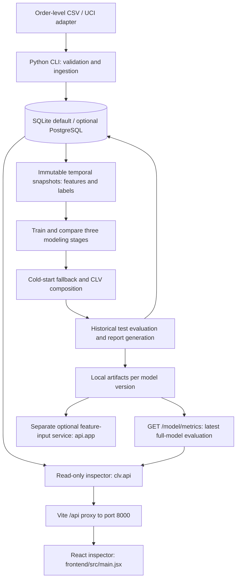

# Product Requirements Document: Customer Lifetime Value (CLV) Prediction System

**Version:** 1.1
**Updated:** 29 October 2026
**Status:** Implemented local system with remaining product requirements identified below
**Owner:** Pavvan
**Approach:** Three-stage supervised ML pipeline with a separate cold-start path

## 1. Product overview

The system estimates gross purchase revenue over the next 90 days for customers with transaction history. Marketing and retention users can rank customers, inspect purchase probability and expected order behavior, and compare customer segments. Business users can inspect aggregate predicted revenue and measured historical model performance.

CLV here means 90-day gross purchase revenue, without discounting, margins, or refunds. It is not profit or multi-year lifetime value. Predictions do not establish the effect of a marketing intervention.

### Goals

- Produce purchase probability, conditional transaction count, conditional order value, and combined CLV per customer.
- Measure performance against fully observed historical outcomes using temporal train, validation, and test snapshots.
- Support customers with limited history through an explicit cold-start fallback.
- Retain versioned runs, snapshots, predictions, metrics, and replayable model bundles.
- Present backend data and artifact evaluation results through a local React inspector.

### Scope and exclusions

The implemented pipeline trains and scores labeled historical snapshots. Future-date unlabeled batch scoring is remaining work. Streaming scoring, causal uplift, multi-year LTV, automatic retraining, cloud artifact storage, and production deployment are outside the implemented scope. Customers with no historical purchases require an additional customer source.

## 2. Current architecture



### Component responsibilities

| Component | Responsibility |
|---|---|
| `clv/data.py`, `clv/uci.py` | Validate order data, preserve raw inputs, reject invalid rows, adapt UCI item lines to orders |
| `clv/features.py` | Build cutoff-safe features and fully observed 90-day labels; persist snapshot identity |
| `clv/ml.py`, `clv/regressors.py` | Compare models, select on validation, calibrate when configured, score test snapshots |
| `clv/revenue.py`, `clv/drift.py` | Cold-start estimates, composition, optional correction and calibration |
| `clv/reports.py` | Generate historical CLV evaluation plots |
| `clv/models.py`, `migrations/` | SQLAlchemy schema and Alembic migrations |
| `clv/api.py` | Serve stored customer/prediction data, run metadata, and artifact evaluation metrics |
| `frontend/src/main.jsx` | Active React entry point and inspector pages |
| `api/app.py` | Separate optional request-time prediction service loading a full bundle at startup |

The inspector and feature-input inference service have different endpoint contracts. The Vite inspector uses `clv.api:app`, not `api.app:app`. The legacy TypeScript page files and root `src/main.jsx` are not the active entry point referenced by `frontend/index.html`.

SQLite is the default local database; PostgreSQL is optional through Docker Compose. Artifacts are local under `ARTIFACT_DIR` (default `artifacts`). S3 and scheduler configuration names are reserved placeholders, not deployed capabilities.

## 3. Data requirements and persistence

### Input contract

One row represents one completed order. Required fields are `customer_id`, `order_id`, `purchased_at`, and `amount`; `category` and `status` are optional. Order IDs must be globally unique. Amounts must be positive and all input must use one reporting currency. No exchange conversion is performed. UCI Online Retail II amounts are GBP.

Timestamps are normalized to UTC; naive timestamps are interpreted as UTC. Non-completed orders, cancellations, invalid amounts, missing identifiers, and duplicate/conflicting orders are rejected while preserving source evidence. File-byte fingerprints make repeated ingestion of an identical source idempotent. The UCI adapter aggregates invoice item lines and does not infer categories from descriptions.

### Persisted entities

| Table | Purpose and identity |
|---|---|
| `ingestion_batches` | Source fingerprint, retained decoded CSV, ingestion counts |
| `raw_transactions` | Original payload, row number, rejection reason; unique batch/row |
| `customers` | Customer identifier, up to 128 characters |
| `transactions` | Clean positive order totals, customer, UTC timestamp, optional category, source link |
| `data_snapshots` | Cutoff, horizon, coverage end, dataset fingerprint, feature definition version |
| `customer_rfm_summary` | Feature JSON and cold-start flag; keyed by snapshot/customer |
| `snapshot_labels` | Purchase, count, revenue, mean order value; keyed by snapshot/customer |
| `model_runs` | Version, timestamp, status, selected models, summary errors, metadata JSON, artifact path |
| `stage1_predictions` | Purchase probability; keyed by model/snapshot/customer |
| `clv_predictions` | Probability, conditional count/value, CLV, segment, cold-start flag, timestamp; keyed by model/customer/snapshot |

Model versions use UUID hex strings. Snapshot identity incorporates source batch fingerprints, cutoff, coverage end, horizon, and definition version. Historical runs and snapshots are retained. SQLAlchemy models and migrations are the schema authority; the original draft SQL is superseded by them.

## 4. Features, labels, and temporal isolation

Customers are eligible if they have at least one completed order strictly before cutoff `t`. Labels use `[t, t + 90 days)`. Coverage must extend through the full target horizon; observation end is exclusive and must be later than all source transactions. Train, validation, and test cutoffs must be chronological and at least 90 days apart.

| Feature | Definition |
|---|---|
| `recency` | Fractional days since last historical order |
| `frequency` | All completed orders before cutoff |
| `T` | Fractional days since first historical order |
| `avg_order_value` | Mean historical order total |
| `monetary_std` | Population standard deviation of historical order totals |
| `purchase_velocity` | Slope of counts in six consecutive 30-day bins, oldest to newest |
| `interpurchase_time_mean`, `interpurchase_time_std` | Mean and population standard deviation of chronological order intervals |
| `category_diversity` | Distinct known historical categories |
| `category_missing` | Whether all historical categories are missing |
| `tenure_bucket` | New below 30 days; established below 365 days; loyal otherwise |
| `last_order_recency_ratio` | `recency / max(T, 1e-9)` |

Cold start means fewer than two historical orders **or** tenure below 30 days. First-order value is also exported as cutoff-safe auxiliary input for the cold-start revenue fallback.

Labels are purchase indicator, order count, summed revenue, and mean order value. Non-purchasers have zero count/revenue and null mean order value. The same customer may appear across temporal snapshots; later snapshots may use purchases already known at their cutoff. Preprocessing fits on training data only. Test results must not determine model selection or calibration.

## 5. Modeling requirements

### Stage 1: purchase probability

Compare constant, logistic regression, random forest, and available optional boosted classifier candidates. Train on established customers. Select minimum validation Brier score, breaking ties by higher ROC-AUC and then name. The constant baseline may win. Optional-library availability and skipped candidates must be recorded.

The current CLI defaults to sigmoid probability calibration fitted on established validation customers. Cold-start probability uses the training cold-start purchase rate smoothed with ten pseudo-observations at the overall training rate. Report Brier score, ROC-AUC, PR-AUC, precision/recall at 0.5, ranking lift, and sample count; retain raw and calibrated diagnostics.

### Stage 2: conditional transaction count

Train and evaluate on established customers who purchased in the outcome window. Candidates include mean baseline, Poisson, optional negative binomial, LightGBM Poisson, and XGBoost Poisson. Select minimum validation RMSE, then MAE. Report RMSE, MAE, sample count, and Poisson deviance. Final count composition enforces at least one conditional transaction; optional scalar correction is fitted on validation purchasers.

### Stage 3: conditional order value

Train and evaluate on established purchasers. Compare mean, Gamma, and available boosted Gamma/log-target models. Select minimum validation MAE, then RMSE. Invert log targets before computing original-scale errors. Report RMSE, MAE, and sample count.

### Combined revenue and cold start

For established customers:

```text
raw_clv = P(purchase) * E[count | purchase] * E[order value | purchase]
final_clv = configured_postprocessing(raw_clv)
```

Multiplying conditional count and value assumes separability; combined revenue evaluation must measure the resulting error directly. Cold-start CLV uses training-only first-order-value buckets with prior smoothing, replacing the three-stage product for that cohort.

Current CLI defaults are sigmoid classifier calibration, no count correction, two cold-start buckets with prior strength 50, no revenue calibration, and no cap. Optional revenue controls include scalar/isotonic calibration, cohort-specific/shared fitting, established-cohort calibration, and a cap. Calibration diagnostics are fitting diagnostics, not independent evaluation. The selected run's saved configuration is authoritative; experimental document defaults may differ from current CLI defaults.

Segments use predicted CLV quartiles: VIP at or above the upper threshold; otherwise At-Risk when probability is below 0.3 and frequency is at least two; otherwise Growth at or above the lower threshold; otherwise Low-Priority. Persist thresholds for replay.

## 6. Artifacts and model identity

Each training run writes to `ARTIFACT_DIR/<model_version>/`. Artifacts include `metrics.json`, the stage-one `model.joblib`, a completed pipeline's `full_model.joblib`, feature exports, prediction/evaluation CSVs, and `clv_report.png`. Full bundles retain fitted stages, feature definitions, calibration settings, cold-start parameters, and segment thresholds. Only trusted joblib bundles may be loaded.

There are three distinct meanings of latest:

- `/model/status`: newest database run by training timestamp, then model version; it may be stage-one only.
- Default prediction queries: newest run with saved predictions, with a prediction-timestamp fallback for CLV where needed.
- `/model/metrics`: artifact directory whose `full_model.joblib` has the newest modification time; directory name breaks ties. Incomplete runs without a full bundle are excluded.

The metrics endpoint reads the matching `metrics.json` on each request without loading the model bundle. It validates report identity against the directory name and rejects invalid/non-finite JSON numbers. No full artifact returns 404; unreadable, invalid, or mismatched latest metrics return 503 without silently falling back to older results. The response projects model version, winner, validation, test, stage2, stage3, combined, and cutoffs when present.

## 7. Inspector backend contract

Run `clv.api:app` on loopback port 8000. All implemented inspector routes are GET:

| Endpoint | Behavior |
|---|---|
| `/health` | Database connectivity check and service status |
| `/customers` | Paginated customer IDs |
| `/model/status` | Latest database run metadata |
| `/model/metrics` | Latest completed artifact's evaluation results |
| `/stage1/predictions` | Paginated purchase probabilities, optional model version |
| `/clv/predictions` | Paginated CLV breakdown; filters for version, customer, segment, cold start, minimum/maximum CLV |
| `/clv/summary` | Version-specific count, predicted total/mean, mean probability/count, cold-start share, segment counts |

Paginated inspector endpoints accept limits from 1 to 500 and nonnegative offsets. CLV predictions sort by descending CLV, then customer ID. No prediction rows returns an empty result rather than invented values. Training runs through the CLI; the inspector has no HTTP retraining trigger.

The separate `api.app` service offers feature-input `POST /predict` and loads its latest full bundle at process startup. It also contains stage-one inspection/demo routes; it is not interchangeable with the inspector API. Any production use of its demo training route requires a separate access-control review.

## 8. Frontend requirements

The active frontend uses React, React Router, Vite, Tailwind CSS, Recharts, and Lucide icons. Development requests use `/api`, proxied to `http://127.0.0.1:8000` with the prefix removed.

| Route | Current purpose |
|---|---|
| `/` | Dashboard with prediction totals and segment summaries |
| `/customers` | Customer and prediction inspection |
| `/clv-prediction` | Stored customer-level CLV breakdown |
| `/analytics` | Segment distribution and predicted CLV charts |
| `/model-performance` | Run metadata and artifact-backed evaluation widget |

### Evaluation widget acceptance requirements

- Fetch `/model/metrics` with the shared refresh flow and show the evaluated artifact version.
- Show historical 90-day test context and monetary errors in source-data units.
- Display combined RMSE, MAE, and signed aggregate revenue error percentage.
- Display purchase ROC-AUC, PR-AUC, Brier score, precision, and recall.
- Display transaction-count and order-value RMSE/MAE with their established-purchaser population context.
- Display evaluation sample counts when available; do not substitute prediction volume for evaluation count.
- Preserve valid zero scores. Missing, null, or non-finite values display as unavailable.
- Show loading/error states and warn when database model status and evaluated artifact versions differ.
- Use encoding-safe separators in titles. Refresh must re-read the latest artifact metrics.

The widget shows final test metrics, an interpretation of signed aggregate revenue error, and validation baseline comparisons for the selected classifier/count/value models. Baselines use constant purchase probability and training-mean count/value predictions. Comparisons require matching sample counts and finite scores, and show relative error improvement or regression. Baseline test scores and combined CLV baseline scores are not stored, so the widget explicitly avoids claiming test-set improvement. Full candidate comparisons, cohort error breakdowns, and calibration curves are future extensions. Customer transaction timelines and CSV export are also remaining product work. Currency-aware presentation across the inspector remains necessary: the existing INR formatter does not imply that GBP source amounts were converted.

## 9. Operations, quality, and delivery

Python 3.12+ is required. Core dependencies include pandas, NumPy, scikit-learn, SQLAlchemy, Alembic, FastAPI, joblib, and Matplotlib; optional modeling dependencies include LightGBM, CatBoost, XGBoost, and statsmodels. `requirements-lock.txt` captures the Windows runtime. `DATABASE_URL` and `ARTIFACT_DIR` configure local persistence.

Use the CLI for database initialization, ingestion, features, stage-one training (`train`), and full training (`train-all`). See [README](README.md) for commands. Keep unauthenticated development services bound to loopback. Production auth, TLS, access control, backups, monitoring, and deployment are remaining requirements. No endpoint latency benchmark has yet established an SLA.

Required checks cover ingestion idempotency/rejections, cutoff leakage, snapshot identity, model selection, calibration replay, cold-start behavior, combined revenue calculation, artifact metrics selection and error handling, and frontend production builds. Relevant checks live in `tests/`; optional PostgreSQL integration needs its database service. Metrics API tests cover newest complete selection, missing artifacts, and refusal to fall back from invalid latest metadata.

## 10. Success criteria and remaining work

| Criterion | Requirement/status |
|---|---|
| Purchase discrimination | Test ROC-AUC target at least 0.75; measured and reported, not enforced as a training guarantee |
| Combined revenue | Provisional aggregate error target within +/-15%; must be assessed per real dataset/run |
| Ranking | Report actual revenue share captured by the highest predicted CLV decile |
| Reproducibility | Preserve data fingerprint, snapshots, selected models, configuration, and replay artifacts |
| Frontend integrity | Evaluation scores come from the identified latest completed artifact, with explicit missing/error states |
| Performance | Original sub-300ms endpoint target requires measurement, including pagination and file reads |

Implemented foundation includes raw-data preservation, immutable snapshots, three-stage training, cold-start handling, versioned persistence, visual evaluation, inspector pages, and artifact-backed metrics.

Remaining work includes unlabeled future scoring, consistent currency presentation, explicit production model promotion, atomic artifact publication, scalable summary aggregation, richer evaluation views, customer timelines/export, production access controls, cloud storage, and scheduling. These are not prerequisites already satisfied by the local prototype.

## 11. Risks and interpretation limits

- Temporal drift and rare large orders can dominate combined errors; inspect per-customer and aggregate results together.
- Cold-start customers have limited signal. Acquisition channels and category-based cohorts are unavailable unless supplied by source data.
- Repeated inspection or tuning against published test results makes that period unsuitable as a fresh final holdout; obtain a new period for independent confirmation.
- Newest filesystem modification time is a local selection rule, not production model approval. Copying a bundle can change which artifact is selected.
- Filesystem artifacts and database runs can diverge. Show their identities and avoid claiming that metrics describe another run's predictions.
- Concurrent artifact writes can temporarily produce unavailable metrics. Atomic completion manifests are future work.
- Historical gross-revenue accuracy does not establish profitability, causal campaign benefit, or performance on future unseen market conditions.

## 12. Supporting references

- [Setup and CLI usage](README.md)
- [Data contract and temporal definitions](docs/data-model.md)
- [Pipeline improvement results](docs/pipeline-improvement-results.md)
- [Ordered drift experiments](docs/ordered-drift-results.md)
- [Manual verification](docs/manual-ml-verification.md)

This revision replaces the original proposed PostgreSQL-only architecture, draft SQL, and planned endpoint list with the implemented system. Where older experiment documents describe different defaults, current CLI options and each saved run's metadata take precedence.
