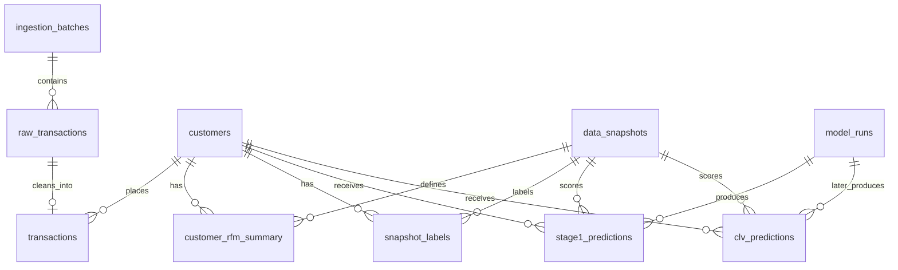

# Data contract and modelling decisions

## Canonical CSV

```csv
customer_id,order_id,purchased_at,amount,category,status
C001,O001,2024-01-01T12:00:00Z,45.50,home,completed
```

Required columns: `customer_id`, `order_id`, `purchased_at`, `amount`. IDs are strings of 1–128 characters; surrounding identifier whitespace is trimmed. `order_id` is globally unique across customers. A row represents one order, not a line item. `category` is one optional representative order category (up to 256 characters); diversity is over known categories. Multi-category item datasets need an adapter before ingestion. `status` is optional and defaults to completed. Any explicit non-completed status is rejected.

Only positive completed-purchase order totals are used. Returns/cancellations and negative amounts are retained in raw data but excluded, so this version predicts gross purchase propensity, not net revenue after refunds. Amounts use two decimal places and half-up rounding. All data must use one currency; no currency conversion is inferred. Naive timestamps are interpreted as UTC; aware timestamps are normalized to UTC and stored without an offset.

The complete decoded source CSV is retained on the ingestion batch, alongside SHA-256 of the original file bytes. Raw rows retain original field values and row numbers, with a rejection reason. Identical source bytes are ingested once; duplicate orders from another file are rejected. Conflicting IDs are flagged rather than overwritten. Source metadata and retained raw inputs support audit/reprocessing; the application offers no mutation API for raw records.

## Relationships



Feature values are stored in a versioned JSON payload keyed by snapshot and customer; labels occupy separate relational columns. Inspect features through exported CSVs, or inspect the payload using PostgreSQL JSON operators / SQLite JSON functions. Snapshot IDs hash source batch fingerprints, observation cutoff, horizon, coverage end, and feature definition version. Adding a source batch produces new snapshot identities. Model IDs are UUIDs; historical runs and predictions are retained. Customers have no globally computed first-purchase field that could accidentally leak into historical features.

## Feature definitions (v1)

Every feature uses orders strictly before cutoff. Eligible customers have at least one such order; customers acquired only after cutoff are excluded.

| Feature | Definition |
|---|---|
| recency | Fractional UTC days from last historical order to cutoff |
| frequency | Count of all historical completed orders before cutoff |
| T | Fractional UTC days from first historical order to cutoff |
| avg_order_value | Mean historical order total |
| monetary_std | Population standard deviation of order totals; zero for one order |
| purchase_velocity | Linear slope of order counts in six consecutive 30-day bins ending at cutoff, oldest first |
| interpurchase_time_mean/std | Mean and population standard deviation of chronological order intervals in days; zero with one order |
| category_diversity | Distinct non-missing representative order categories |
| category_missing | 1 if all historical categories are absent |
| tenure_bucket | new below 30 days; established below 365 days; loyal otherwise |
| last_order_recency_ratio | recency / max(T, 1e-9) |

Cold start means fewer than two historical orders OR tenure below 30 days. Thresholds are fixed in v1 feature definitions; change the definition version when changing them. Registered-but-never-purchased customers require a separate customer source and are not represented by this transaction-only input.

## Labels and time isolation

For cutoff `t`, the target window is `[t, t + 90 days)`. A purchase exactly at cutoff is a label event, not a feature. A purchase at the horizon end is excluded. Only windows with asserted complete source coverage are accepted.

- `purchased`: 1 if at least one order occurs in the window.
- `transaction_count`: number of orders (including zero).
- `revenue`: sum of order totals (zero for non-purchasers).
- `mean_order_value`: mean order total; null for non-purchasers.

Training, validation and test cutoffs must each be at least 90 days apart. The same customer may appear in multiple periods; this is intentional evaluation of future purchases among existing customers. Preprocessing is fit on training history only. The final test is never used for selection. Later training features may include previous label-period purchases because those purchases are known at that later cutoff.

Established customers train the classifiers. Cold-start probabilities use the training cold-start purchase rate with ten pseudo-observations at the overall training purchase rate; no validation/test labels enter that fallback. The constant baseline also uses this same cold-start path. Select the lowest validation Brier score, break ties with ROC-AUC then model name. A constant baseline can legitimately win. No post-hoc calibration is fitted; calibration is measured and plotted.

Stage 2 will estimate transaction count **conditional on purchasing**, and stage 3 mean order value conditional on purchasing. No count/value outputs are fabricated now; `clv_predictions` remains empty until those models exist. Their dependence and combined revenue accuracy must be checked before treating the product of outputs as a reliable CLV estimate.

## Direct inspection queries

```sql
SELECT rejection_reason, COUNT(*) FROM raw_transactions GROUP BY rejection_reason;
SELECT COUNT(*) AS orders, SUM(amount) AS gross_revenue FROM transactions;
SELECT snapshot_id, COUNT(*) AS customers FROM customer_rfm_summary GROUP BY snapshot_id;
SELECT snapshot_id, SUM(purchased) AS purchasers, SUM(revenue) AS revenue
FROM snapshot_labels GROUP BY snapshot_id;
SELECT customer_id, prob_purchase, is_cold_start FROM stage1_predictions
ORDER BY prob_purchase DESC LIMIT 20;
```
